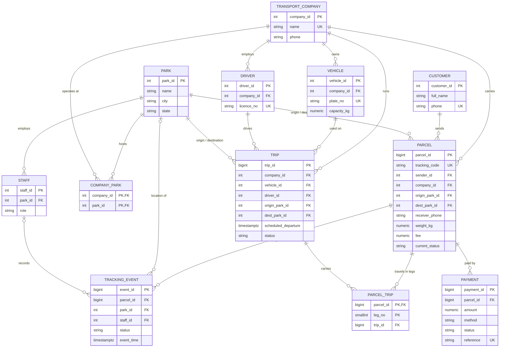

# Portfolio 1 — Database Design and Modelling

**Case study:** ParcelPark — inter-city motor park parcel tracking platform
**DBMS:** PostgreSQL 17

## Files

| File | Purpose |
|---|---|
| `schema.sql` | Creates all 12 tables with keys and constraints (re-runnable) |
| `seed.sql` | Small realistic sample dataset |
| `constraint_tests.sql` | 9 deliberately invalid statements that the database must reject |
| `screenshots/` | Evidence of schema creation, data, and constraint errors |

**How to run:** execute `schema.sql`, then `seed.sql`, then `constraint_tests.sql` (every statement in the last file should fail with an error).

---

## 1. ER Diagram

## 2. Relational Schema

(PK = primary key, FK = foreign key, UK = unique)

- **park** (<u>park_id</u>, name, city, state, address) — UK(name, city)
- **transport_company** (<u>company_id</u>, name UK, phone, email UK, joined_at)
- **company_park** (<u>company_id</u> FK, <u>park_id</u> FK)
- **vehicle** (<u>vehicle_id</u>, company_id FK, plate_no UK, vehicle_type, capacity_kg)
- **driver** (<u>driver_id</u>, company_id FK, full_name, phone UK, licence_no UK)
- **staff** (<u>staff_id</u>, park_id FK, full_name, phone UK, role)
- **customer** (<u>customer_id</u>, full_name, phone UK, email UK, created_at)
- **parcel** (<u>parcel_id</u>, tracking_code UK, sender_id FK, company_id FK, receiver_name, receiver_phone, origin_park_id FK, dest_park_id FK, description, weight_kg, declared_value, fee, current_status, created_at)
- **trip** (<u>trip_id</u>, company_id, vehicle_id, driver_id, origin_park_id FK, dest_park_id FK, scheduled_departure, actual_departure, actual_arrival, status) — FK(vehicle_id, company_id) → vehicle, FK(driver_id, company_id) → driver
- **parcel_trip** (<u>parcel_id</u>, <u>leg_no</u>, trip_id, company_id, loaded_at) — FK(parcel_id, company_id) → parcel, FK(trip_id, company_id) → trip
- **tracking_event** (<u>event_id</u>, parcel_id FK, park_id FK, staff_id FK, status, note, event_time)
- **payment** (<u>payment_id</u>, parcel_id FK, amount, method, status, reference UK, paid_at)

## 3. Keys and Constraints

| Type | Example | Business rule enforced |
|---|---|---|
| Surrogate PK | `GENERATED ALWAYS AS IDENTITY` on all entity tables | Stable, meaningless identifiers |
| Composite PK | `company_park(company_id, park_id)`, `parcel_trip(parcel_id, leg_no)` | M:N relationships; ordered legs |
| Natural UK | `tracking_code`, `plate_no`, `licence_no`, payment `reference` | Real-world identifiers cannot repeat |
| CHECK | `origin_park_id <> dest_park_id`, `weight_kg > 0`, status lists | Valid routes, values and states |
| CHECK (multi-column) | `actual_arrival > actual_departure` | Time consistency of trips |
| Composite FK | `trip(vehicle_id, company_id)` → `vehicle` | A trip's vehicle **and** driver must belong to the same company |
| Composite FK | `parcel_trip(parcel_id, company_id)` → `parcel` | A parcel can only travel on its own carrier's trips |
| Partial unique index | `payment(parcel_id) WHERE status='successful'` | At most one successful payment per parcel (failed attempts allowed) |
| FK (default RESTRICT) | `parcel.sender_id` → `customer` | Customers with parcel history cannot be deleted |

All rules are verified in `constraint_tests.sql` (T1–T9).

## 4. Normalisation

**1NF.** Every column holds one atomic value. There are no repeating groups. A parcel's multiple legs are stored as rows in `parcel_trip` instead of columns like `trip1, trip2`. Its status history is stored as rows in `tracking_event` instead of a list inside `parcel`.

**2NF.** Every non-key attribute depends on the whole of its key. The only tables with composite keys are `company_park` (no non-key attributes) and `parcel_trip`. In `parcel_trip`, `trip_id` and `loaded_at` describe one specific leg of one specific parcel, so they depend on the full key `(parcel_id, leg_no)`.

**3NF.** No non-key attribute depends on another non-key attribute. For example:
- Park details such as city and state live only in `park`. `parcel` and `trip` store only `park_id`.
- Company details are stored once, in `transport_company`.
- Vehicle capacity lives in `vehicle`, not in `trip`.

An unnormalised design, such as a single "shipment sheet" holding sender name, sender phone, park city and driver name on every row, would suffer update anomalies. If a park's address changed, it would have to be corrected on thousands of rows.

**Deliberate, controlled exceptions**

1. **`trip.company_id` and `parcel_trip.company_id`.** Strictly, `trip_id → vehicle_id → company_id` is a transitive dependency. It is kept on purpose, because it lets composite foreign keys enforce a cross-table rule that plain FKs cannot: the vehicle, the driver, the trip and the parcel must all belong to the same company. The redundancy cannot become inconsistent, because the composite FK rejects any mismatch (see tests T5 and T6).
2. **`parcel.current_status`.** This value could be derived from the latest `tracking_event` row. It is stored for read performance, because "where is my parcel?" is the most frequent query. Portfolio 3 keeps it consistent by updating `parcel` and inserting the `tracking_event` row in the same transaction.
3. **Receiver details on `parcel`.** Receivers are often not registered users, so `receiver_name` and `receiver_phone` describe this particular parcel. They do not form a separate entity, so this does not violate 3NF.

The design is in **BCNF** apart from the two denormalisations above, which were chosen deliberately.
