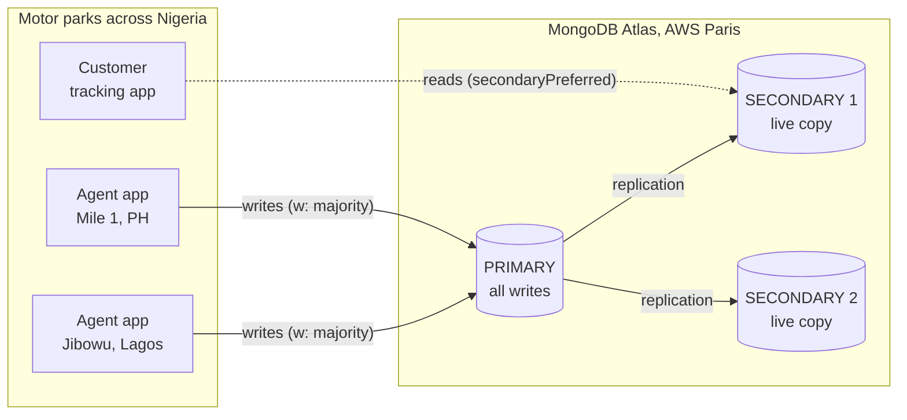
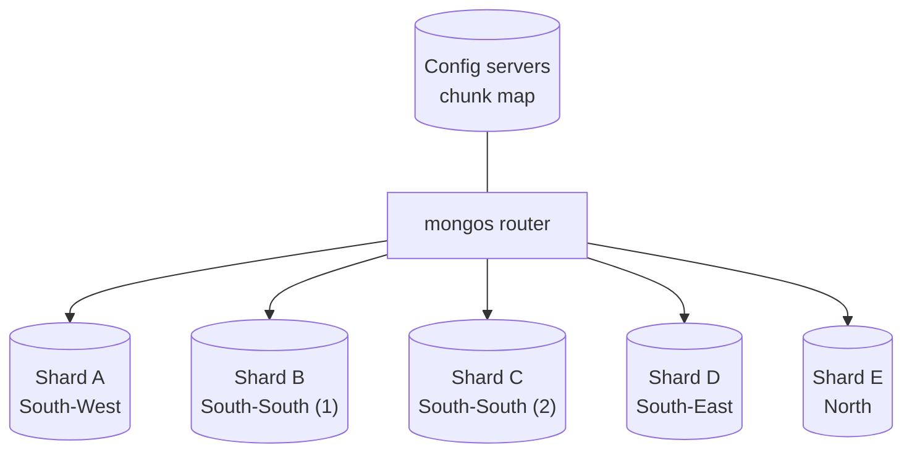

# Portfolio 5 — Distributed and Cloud Database Exercise

**Case study:** ParcelPark | **Platform:** MongoDB Atlas (AWS, Paris eu-west-3, free M0 tier) | **Tools:** Atlas web console, MongoDB Compass + `mongosh`

## Aim
To deploy ParcelPark's NoSQL database in the cloud, prove that it is **replicated** across several servers, measure the trade-off between **consistency and speed**, and design how ParcelPark would be **sharded** across Nigeria as it grows.

## Files

| File | Purpose |
|---|---|
| `distributed_tests.js` | Blocks D0–D8, pasted one at a time into `mongosh` |
| `screenshots/` | Atlas console and shell evidence |

The same `parcelpark` database from Portfolio 4 is used (5,000 parcels, 20 parks, 42 routes).

---

## 1. Cloud deployment

ParcelPark's document database runs as a managed **MongoDB Atlas** cluster:

| Setting | Value |
|---|---|
| Provider / region | AWS, Paris (eu-west-3), one of the closest free-tier regions to Nigeria |
| Tier | M0 (free, shared) |
| Topology | **Replica set of 3 servers**, created automatically by Atlas |
| Security | Database user with password authentication, plus an IP access list. Connections are TLS-encrypted (`mongodb+srv://`) |

Using a managed service means backups, patching, monitoring and failover are handled by the provider. For a small Nigerian logistics start-up, that is more realistic than running and maintaining its own servers.

## 2. Replication (D1–D3)

| Test | Result |
|---|---|
| **D1** `db.hello()` | Replica set `atlas-awr7cr-shard-0` with **3 servers** (`…shard-00-00`, `…-01`, `…-02`). Primary: `…shard-00-02`; the other two are secondaries |
| **D2** same parcel read with `readPref("primary")` and `readPref("secondary")` | Answered by **two different servers** (primary `…shard-00-02`, secondary `…shard-00-01`), and both returned the parcel |
| **D3** insert on the primary, then read from a secondary | The new tracking event `PP26999999` was written to the primary with `w:"majority"` and read back from a secondary |

**Why it matters for ParcelPark:**
- **High availability.** If the primary fails, the two secondaries hold an **election** and one becomes the new primary within seconds. Drivers retry writes automatically (*retryable writes*), so park agents keep working.
- **Durability.** Every parcel exists on three servers, so losing one server loses no data.
- **Read scaling.** Customer tracking lookups, the most frequent query, can be served by secondaries, which takes load off the primary.

**Replication lag (D3):** a secondary can be a fraction of a second behind the primary. A customer reading from a secondary could briefly see a slightly old status. This is **eventual consistency**. It is acceptable for "where is my parcel?", but not for payments or vehicle capacity checks, which must read from the primary.

## 3. Consistency vs speed: write concerns (D4)

| Write concern | Meaning | Average time per write (measured) |
|---|---|---|
| `w: 0` | Fire and forget, no confirmation | 3 ms |
| `w: 1` | The primary confirms the write | 134 ms |
| `w: "majority"` | The primary **and** at least one secondary confirm | 138 ms |

**Analysis:** the more servers that must confirm a write, the slower it is, but the safer it is. A `w:1` write that the primary acknowledges and then loses in a crash, before it reaches a secondary, can be **rolled back** after failover. With `w:"majority"`, the write is already on two of the three servers, so it survives any single failure.

Most of the measured time is the **network round trip from Nigeria to Paris**. The extra cost of `majority` (waiting for a secondary in the same data centre) is small by comparison. In this test, `majority` cost only **4 ms more** than `w:1` (138 vs 134 ms, about 3%), while the ~130 ms baseline is almost entirely the Lagos-to-Paris network round trip. A data-centre region in Africa (e.g. AWS Cape Town) would cut that baseline substantially. **ParcelPark's choice:** `w:"majority"` for parcel registration, payments and status changes. The small extra delay is worth never losing a customer's parcel record. `w:1` or `w:0` would only suit low-value data such as analytics events.

## 4. CAP theorem in ParcelPark

During a **network partition**, a distributed database must choose between **Consistency** and **Availability**:
- MongoDB with majority writes behaves as **CP**. A primary that loses contact with the majority steps down and refuses writes, so two servers can never both accept conflicting updates. This is the same "never overload the car" principle as Portfolio 3, now across servers.
- **The Nigerian reality:** motor parks often have unreliable internet. When a park loses connectivity, the database cannot be reached at all. The practical answer is an **offline-first agent app**:
  - It records tracking events locally, each with a unique event ID.
  - It syncs them when the connection returns.
  - Unique IDs make the sync **idempotent**, so re-sending the same event never creates duplicates.

  This gives **availability at the edge** and **consistency in the core**.

## 5. Sharding design (D5–D7)

**D5:** `sh.status()` confirms that the free M0 cluster is a replica set, **not** a sharded cluster. Sharding needs a dedicated tier (M30+). It is therefore presented here as a **design**, backed by measurements from the real data.

**Why ParcelPark would need sharding:** at national scale (millions of parcels and 10+ tracking events each), a single replica set eventually runs out of write capacity and storage. **Sharding** splits a collection across several replica sets (*shards*), each holding part of the data.

**Choosing a shard key (D6): distinct values in 5,000 parcels**

| Candidate | Distinct values | Verdict |
|---|---|---|
| `tracking_code` | 5,000 | Excellent cardinality and every lookup uses it, but on its own it gives no regional locality |
| `sender.phone` | 1,440 | Good cardinality, but busy customers create hot spots |
| `company.name` | 20 | Too few values: at most 20 chunks |
| `origin.city` | 16 | Too few values, and uneven |
| `status` | 6 | Terrible: most parcels are "collected", so it would create one giant shard |

**Zone distribution (D7): parcels per geopolitical zone**

| Zone | Parcels | % |
|---|---|---|
| South-South | 1,746 | 34.9 |
| South-East | 1,064 | 21.3 |
| South-West | 956 | 19.1 |
| North-Central | 772 | 15.4 |
| North-West | 462 | 9.2 |

The zones are **uneven**: South-South holds almost **4×** as many parcels as North-West (34.9% vs 9.2%). South-South has several busy parks, while North-West has fewer. A key based on zone alone would overload some shards.

**Recommended shard key:** `{ zone: 1, tracking_code: "hashed" }` (a compound hashed key)
- **`zone` first** → with *zone sharding*, each region's data can live on a shard hosted near that region (e.g. a Lagos data centre for South-West), which lowers latency for local agents.
- **Hashed `tracking_code` second** → spreads parcels evenly across chunks *within* a zone, so a busy zone like South-South can itself be split over several shards.
- **"Where is my parcel?"** queries include the tracking code, so they still go to **one** shard (a *targeted* query) instead of all of them (*scatter-gather*).

Each shard is itself a 3-server replica set, so the system is both **partitioned** (for scale) and **replicated** (for availability).

## 6. The relational side
ParcelPark's PostgreSQL database (Portfolios 1–3) would be deployed on a managed cloud service, such as Amazon RDS, Azure Database for PostgreSQL or Neon, using **streaming replication**: one primary for payments and trip loading, plus read replicas for the reporting queries from Portfolio 2. Financial and capacity data stays in PostgreSQL, where Portfolio 3 showed strict transactional control. Tracking and the park network live in MongoDB. This is the **polyglot persistence** architecture recommended in Portfolio 4.
